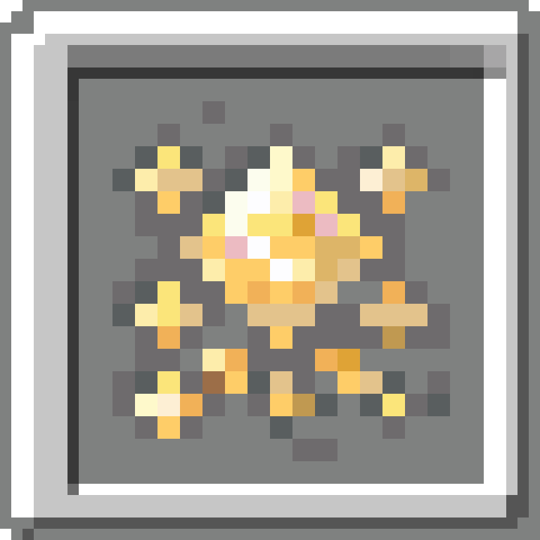

<!-- PROJECT BADGES -->

![Version][version-badge]
[![Downloads][release-badge]][releases-url]
[![Stars][stars-badge]][stars-url]
[![License][license-badge]][license-url]

<!-- PROJECT LOGO -->
 

  
  <h3>AFKMine</h3>
  

    Immersive AFK mining with a cinematic camera experience.

[Korean README](README_KOR.md) · [Report a bug][issues-url] · [Request a feature][issues-url]

  

<!-- ABOUT THE PROJECT -->

## About The Project

This plugin is a PoC made to test the CameraAPI plugin and the presentkim Composer libraries.

:heavy_check_mark: Create AFK mines in-game  
:heavy_check_mark: Watch a dummy miner mining ores via a cinematic camera path  
:heavy_check_mark: Receive real drops as rewards over time  
:heavy_check_mark: Supports multilingual messages and localized default config via `libmultilingual`  
:heavy_check_mark: Restores original blocks when deleting a mine  

##

-----

#### Requirements

- [axolotl-pm/PocketMine-MP](https://github.com/axolotl-pm/PocketMine-MP) **5.51** or higher (`plugin.yml` `api: [5.51.0]`),
  which uses BedrockProtocol 64 (Bedrock `1.26.60`)
- PHP **8.4** or higher
- The version for the original [pmmp/PocketMine-MP](https://github.com/pmmp/PocketMine-MP) 5.x is kept on the
  [`legacy/pmmp-5.44`](https://github.com/presentkim-pm/AfkMine/tree/legacy/pmmp-5.44) branch

##

-----

#### Dependencies

- **CameraAPI** (plugin dependency)
- Composer libraries used by this plugin (bundled into the released phar, nothing to install):
  - `presentkim/session-utils`
  - `presentkim/selection-visualize-utils`
  - `presentkim/play-sound-utils`
  - `presentkim/libmultilingual`

##

-----

#### Commands & Permissions

- `/afkmineadmin` (permission: `afkmine.command.admin`, default: OP)
  - `create` : enter mine creation mode
  - `list` : list registered mines
  - `delete <name>` : delete a mine by name (restores original blocks for its ore spots)
- `/afkmine` (permission: `afkmine.command.user`, default: true)
  - join/leave an available AFK mine session

##

-----

#### Usage

##### Create a mine (`/afkmineadmin create`)

https://github.com/user-attachments/assets/a9c53a70-d87a-40ec-95f9-35a549908171

1. Your inventory will be replaced with creation tools.
2. Touch blocks / use items to set positions:
   - Ore spot tools (slot 1–3): add/remove ore spots by preset (Stone/Nether/Deepslate)
   - Dummy spawn position
   - Camera position (look-at) (can be added multiple times)
   - Player hide position
   - Save and exit
3. In the save form, set:
   - mine name
   - ore regen interval (ticks)

##### Join AFK mining (`/afkmine`)

https://github.com/user-attachments/assets/45000b04-ac09-4758-82d7-6aa991598f5a

- Start/stop an AFK session in an available mine.
- Rewards are settled every `reward-interval` seconds.

##

-----

## Ore presets

Default presets are registered in `OrePresetRegistry`:

- IDs: `stone`, `nether`, `deepslate`
- Names are localized via libmultilingual keys:
  - `afkmine.orePreset.stone`
  - `afkmine.orePreset.nether`
  - `afkmine.orePreset.deepslate`

You can override presets by registering a new `OrePreset` with the same ID.

##

-----

## Multilingual support

### Messages

- Resource locale files:
  - `resources/locale/eng.ini` (required)
  - `resources/locale/kor.ini`
- Server owners can edit messages in:
  - `plugin_data/AFKMine/locale/*.ini`

### Localized default config

- Resource configs:
  - `resources/config/eng.yml` (required)
  - `resources/config/kor.yml`
- On first run (or if `plugin_data/AFKMine/config.yml` is missing), the plugin saves the server-language matching
  config to:
  - `plugin_data/AFKMine/config.yml`

##

-----

## World restore on mine delete

When you mark blocks as ore spots during creation, AFKMine stores the original block state IDs.
When the mine is deleted (`/afkmineadmin delete <name>`), it restores those blocks so the world
returns to its previous state instead of leaving regenerated ores/base blocks behind.

##

-----

## Installation

1) Install the [CameraAPI](https://github.com/presentkim-pm/CameraAPI) `2.0` plugin
2) Download `AFKMine.phar` from [GitHub Releases][releases-url]
3) Move the downloaded `.phar` file to the server's **/plugins/** folder
4) Restart the server

For development, `composer install` then `composer test` runs the PHPUnit tests.

##

-----

## License

LGPL-3.0-or-later. See the repository [license file][license-url] for more information.

##

-----

[version-badge]: https://img.shields.io/github/v/release/presentkim-pm/AfkMine?display_name=tag&style=for-the-badge&label=VERSION
[stars-badge]: https://img.shields.io/github/stars/presentkim-pm/AfkMine.svg?style=for-the-badge
[license-badge]: https://img.shields.io/github/license/presentkim-pm/AfkMine.svg?style=for-the-badge

[release-badge]: https://img.shields.io/github/downloads/presentkim-pm/AfkMine/total?style=for-the-badge&label=GITHUB%20

[stars-url]: https://github.com/presentkim-pm/AfkMine/stargazers
[releases-url]: https://github.com/presentkim-pm/AfkMine/releases
[issues-url]: https://github.com/presentkim-pm/AfkMine/issues
[license-url]: https://github.com/presentkim-pm/AfkMine/blob/main/LICENSE

